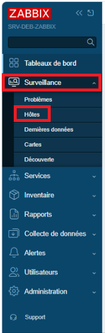
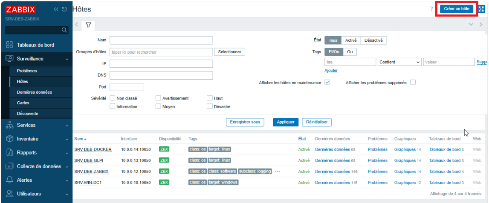
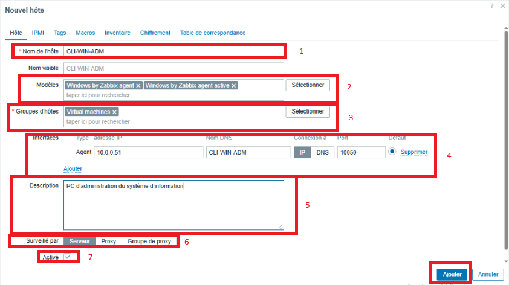
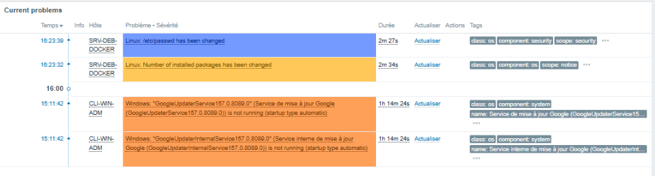
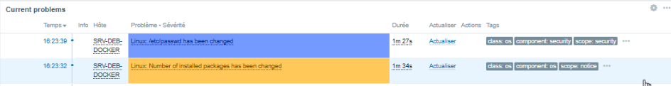
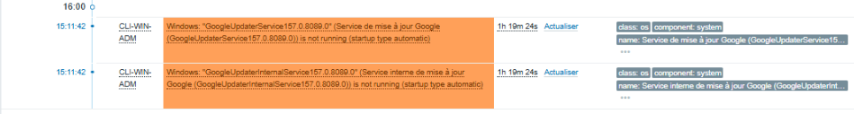
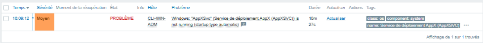
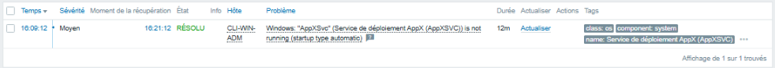

## Créer un hôte sur l'interface web de ZABBIX pour la communication AGENT-SERVEUR  

Sur la page web d'administration ZABBIX, allez dans **Surveillance** puis dans **Hôtes** :  

Une fois arrivé sur la page principale des Hôtes, cliquez sur **Créer un hôte** : 

La page **Nouvel hôte** s'ouvre, remplissez là comme suit et en l'adaptant à l'équipement que vous souhaitez ajouter à la supervision :  

1. **Nom de l'hôte :** Nom de la machine que vous allez superviser /!\DOIT CORRESPONDRE A LA VALEUR INDIQUEE DANS LE FICHIER DE CONFIGURATION : zabbix_agent2.conf/!\  
2. **Modèles :** Cliquez sur **Sélectionner**, dans la nouvelle fenêtre cliquez également sur **Sélectionner**, choisissez le groupe qui correspond à votre type d'équipement (ici **Templates/Operating systems**), cochez Windows by Zabbix agent, recliquez sur **Sélectionner**.  
3. **Groupes d'hôtes :** Cliquez sur **Sélectionner** et adaptez votre choix à l'équipement, puis **Ajouter**  
4. **Interfaces :** Cliquez sur **Ajouter**, puis sur **Agent**, renseignez l'**adresse IP** de l'équipement sur lequel l'agent a été installé, le **nom DNS** renseigné en amont dans le DNS, laissez **IP** grisé et le port 10050 par défaut.  
5. **Description :** Ajoutez une description au besoin.  
6. **Surveillé par :** laissez **Serveur**
7. Et laisser la case **Activé** cochée.
8. Puis cliquez sur **Ajouter**

Une fois l'hôte renseigné et l'ajout préalablement installé (cf. Installation de l'agent dans la documentation install.md de ZABBIX), les informations de l'équipement supervisé devraient remonter.  

Dans le cas où l'encadré ZBX serait gris, vous pouvez faire procédure suivante :  

**Forcer la collecte des données**

Pour accélérer l'activation du voyant :  
Allez dans **Collecte de données** > **Hôtes**.  
Cliquez sur le lien **Elements** sur la ligne de votre serveur Windows.  
Cochez la **case en haut de la liste** pour sélectionner tous les éléments (ou quelques-uns comme Agent ping).  
Cliquez sur le bouton **Exécuter maintenant** tout en bas de la page.  

## Exemple d'utilisation de la supervision

Depuis le dashboard (que vous avez évidemment personnalisé en utilisant la documentation officielle de zabbix), vous voyez des alertes de supervision remonter :  

Les bleues et les jaunes sont respectivement des informations et des avertissements dont le degré de sévérité est bas :  

Les oranges quant à eux sont à surveiller, nous pouvons voir ici des problèmes avec le service de mise à jour de Google :  

En cliquant sur l'un d'entre eux, on arrive sur une fenêtre liée au problème :   

Pour le résoudre, on prend la main sur l'équipement concerné, ici CLI-WIN-ADM, le pc d'administration et on fait les actions suivantes :  

Appuyer sur Win+R puis taper wsreset.exe. Cette action devrait résoudre le problème en capture d'écran (AppXSvc). Retournez sur l'interface web de ZABBIX :  

Le problème est résolu.  

ZABBIX permet de créer des déclencheurs, de personnaliser le dashboard, de checker tout un tas d'information sur les équipements supervisés (charge CPU, utilisation de la mémoire vive, etc). A vous de le personnaliser selon vos besoins.  
