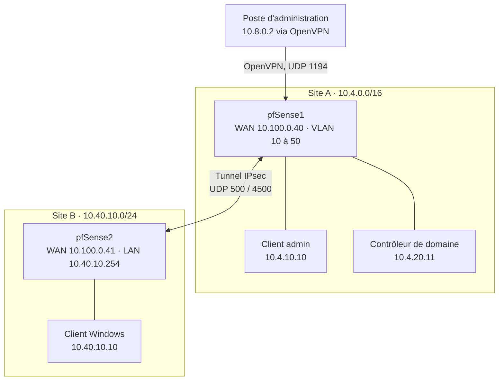

# Interconnexion site à site IPsec entre deux pare-feu pfSense

## 1. Objet

Ce document décrit la mise en place d'un tunnel IPsec site à site entre deux pare-feu pfSense (site A et site B), hébergés en machines virtuelles sur Proxmox. Il couvre le déploiement du second pare-feu, la configuration du tunnel, les règles de filtrage associées et la procédure de validation.

Le tunnel permet aux postes du site B d'atteindre les ressources du site A (contrôleur de domaine, postes d'administration) sur un canal chiffré.

## 2. Architecture



### 2.1 Plan d'adressage

| Élément | Site A (pfSense1) | Site B (pfSense2) |
| --- | --- | --- |
| Nom de la VM | GRP4-FW-pfSense1 | GRP4-FW-pfSense2 |
| IP WAN | 10.100.0.40/24 | 10.100.0.41/24 |
| Passerelle WAN | 10.100.0.1 | 10.100.0.1 |
| Réseau LAN | 10.0.0.0/24 (10.0.0.254) | 10.40.0.0/24 (10.40.0.254) |
| Réseau relié par le tunnel | 10.4.0.0/16 | 10.40.10.0/24 (VLAN 100, passerelle 10.40.10.254) |
| Réseau OpenVPN | 10.8.0.0/24 | non utilisé |
| Postes principaux | Client admin 10.4.10.10, DC 10.4.20.11 | Client Windows 10.40.10.10 |

Les VLAN du site A sont ADMIN (10), INFRA_AD (20), SRV_LINUX (30), DATAS (40) et BACKUP (50). Chaque VLAN a sa passerelle en 10.4.X.254 sur pfSense1.

### 2.2 Principes retenus

- Les adresses sont toutes statiques, aucun service DHCP n'est déployé sur les pfSense.
- Les deux WAN sont sur le même segment (10.100.0.0/24), derrière le bridge `vmbr0` de Proxmox, et jouent le rôle de deux accès Internet distincts.
- Le tunnel utilise IKEv2 avec une clé pré-partagée (PSK).
- Le second pare-feu est installé à partir de l'ISO, et non cloné depuis pfSense1, afin de ne pas dupliquer certificats, VLAN, serveur OpenVPN et adresses.

## 3. Accès d'administration par OpenVPN (existant)

L'accès distant au site A repose sur un serveur OpenVPN hébergé sur pfSense1 (UDP 1194, réseau de tunnel 10.8.0.0/24).

| Paramètre | Valeur |
| --- | --- |
| Interface d'écoute | WAN, UDP 1194 |
| Réseau local annoncé aux clients | 10.4.0.0/16 |
| DNS annoncé aux clients | 10.4.20.11 |
| Règle WAN | Pass, UDP, destination « WAN address », port 1194 |
| Règle OpenVPN | Pass, source 10.8.0.0/24, destination 10.4.10.0/24, au minimum TCP 3389 |

Les routes et le DNS sont transmis aux clients à chaque connexion et ne figurent pas dans le fichier de configuration client. Le WAN de pfSense1 étant en adressage privé, l'équipement situé en amont doit rediriger UDP 1194 vers 10.100.0.40.

Le serveur peut être contrôlé dans **Status → OpenVPN**. Un état « Service not running » indique que le démon est arrêté et doit être relancé avant tout autre diagnostic.

Validation depuis un poste connecté au VPN :

```powershell
Test-NetConnection 10.4.10.10 -Port 3389
```

## 4. Déploiement de pfSense2 sur Proxmox

### 4.1 Machine virtuelle

| Paramètre | Valeur |
| --- | --- |
| Mémoire | 2 Go minimum |
| Carte réseau 1 (WAN, `em0`) | Intel E1000, bridge `vmbr0`, sans VLAN Tag |
| Carte réseau 2 (LAN, `em1`) | Intel E1000, bridge du site B, sans VLAN Tag |
| Pare-feu Proxmox sur les cartes | désactivé |

Le VLAN 100 est créé dans pfSense (section 5.3). Le bridge LAN n'applique donc pas de tag.

### 4.2 Installation

| Écran de l'installeur | Choix |
| --- | --- |
| Partitioning | Auto (UFS) : le stockage et les snapshots sont gérés par Proxmox |
| Partition Scheme | GPT |
| Validation | Finish, puis Commit |
| Fin d'installation | Retirer l'ISO du lecteur virtuel avant le redémarrage |

### 4.3 Assignation des interfaces

Dans le menu de la console, option **1 (Assign Interfaces)** :

1. Configuration des VLAN : non.
2. WAN : `em0`.
3. LAN : `em1`.
4. Interface optionnelle : aucune, puis confirmation.

Si `em1` n'est pas reconnue, la seconde carte n'est pas présente dans la VM. Elle doit être ajoutée dans Proxmox, puis la VM redémarrée.

## 5. Configuration réseau de pfSense2

### 5.1 WAN

Console, option **2 (Set interface(s) IP address)**, interface WAN :

| Question | Réponse |
| --- | --- |
| IPv4 via DHCP | non |
| Adresse IPv4 | 10.100.0.41 |
| Masque | 24 |
| Passerelle amont | 10.100.0.1 |
| IPv6 via DHCP6 | non |
| Retour au HTTP pour le webConfigurator | non |

Contrôle : la console affiche `WAN (wan) -> em0 -> v4: 10.100.0.41/24`, la commande `ifconfig em0` retourne `inet 10.100.0.41`, et **Status → Interfaces** indique la même adresse.

Une modification faite dans **Interfaces → WAN** n'est active qu'après **Save** puis **Apply Changes**. La page **Status → Interfaces** reflète l'état réellement appliqué.

### 5.2 LAN

Console, option **2**, interface LAN : adresse 10.40.0.254, masque 24, aucune passerelle, pas d'IPv6.

### 5.3 VLAN 100 (réseau du site B)

Dans l'interface web (**Interfaces → Assignments**) :

1. Onglet **VLANs** : ajouter un VLAN, interface parente `em1`, tag `100`, description `SITEB`.
2. Onglet **Interface Assignments** : ajouter `VLAN 100 on em1`. L'interface est créée sous le nom `OPT1`.
3. Configurer `OPT1` : activer l'interface, la renommer `SITEB`, type IPv4 **Static IPv4**, adresse 10.40.10.254, masque 24. Enregistrer puis appliquer.

La console doit alors afficher `SITEB (opt1) -> em1.100 -> v4: 10.40.10.254/24`.

### 5.4 Paramètres généraux

- Changement du mot de passe administrateur par défaut.
- **System → General Setup** : hostname `GRP4-FW-pfSense2`, serveur DNS 10.4.20.11.
- **Interfaces → WAN** : désactiver **Block private networks and loopback addresses**. Les deux WAN étant en adressage privé, cette option bloquerait le trafic de l'autre site, y compris IPsec. Elle est également désactivée sur pfSense1.

### 5.5 Vérification de la connectivité entre les WAN

Le pare-feu de chaque WAN rejette l'ICMP entrant par défaut : l'absence de réponse au ping entre les deux WAN n'est donc pas significative. Le contrôle fiable est la table ARP de pfSense1 (**Diagnostics → ARP Table**), qui doit contenir une entrée WAN pour 10.100.0.41 avec l'adresse MAC de pfSense2. Dans le cas contraire, vérifier que les deux cartes WAN sont sur le même bridge Proxmox, sans VLAN Tag.

## 6. Règles de pare-feu sur les WAN

IPsec utilise UDP 500 (IKE) et UDP 4500 (NAT-T). Ces ports doivent être autorisés sur le WAN de chaque pfSense, uniquement depuis l'adresse WAN de l'autre.

| Équipement | Source autorisée |
| --- | --- |
| pfSense2 | 10.100.0.40/32 |
| pfSense1 | 10.100.0.41/32 |

Pour chaque équipement, dans **Firewall → Rules → WAN**, créer deux règles :

| Paramètre | Règle 1 | Règle 2 |
| --- | --- | --- |
| Action | Pass | Pass |
| Famille / protocole | IPv4 / UDP | IPv4 / UDP |
| Source | Network, adresse de l'autre WAN, /32 | idem |
| Destination | WAN address | WAN address |
| Port de destination | ISAKMP (500) | IPsec NAT-T (4500) |
| Description | IPsec ISAKMP | IPsec NAT-T |

Les règles ne sont actives qu'après **Apply Changes**. Sur pfSense1, la règle OpenVPN (UDP 1194) est conservée sans modification.

## 7. Configuration du tunnel IPsec

Les paramètres cryptographiques, la clé pré-partagée et les durées de vie doivent être strictement identiques des deux côtés. Seuls la passerelle distante et les réseaux local et distant sont inversés.

### 7.1 Phase 1 (**VPN → IPsec → Tunnels → Add P1**)

| Paramètre | pfSense2 | pfSense1 |
| --- | --- | --- |
| Key Exchange version | IKEv2 | IKEv2 |
| Internet Protocol | IPv4 | IPv4 |
| Interface | WAN | WAN |
| Remote Gateway | 10.100.0.40 | 10.100.0.41 |
| Description | Vers site A | Vers site B |
| Authentication Method | Mutual PSK | Mutual PSK |
| My identifier / Peer identifier | My IP address / Peer IP address | My IP address / Peer IP address |
| Pre-Shared Key | générée sur pfSense2 | identique à pfSense2 |
| Chiffrement | AES 256 bits | AES 256 bits |
| Hash | SHA256 | SHA256 |
| DH Group | 14 (2048 bits) | 14 (2048 bits) |
| Lifetime | 28800 s | 28800 s |
| NAT Traversal | Auto | Auto |

### 7.2 Phase 2 (**Show Phase 2 Entries → Add P2**)

| Paramètre | pfSense2 | pfSense1 |
| --- | --- | --- |
| Mode | Tunnel IPv4 | Tunnel IPv4 |
| Réseau local | 10.40.10.0/24 | 10.4.0.0/16 |
| Réseau distant | 10.4.0.0/16 | 10.40.10.0/24 |
| Description | LAN B vers LAN A | LAN A vers LAN B |
| Protocole | ESP | ESP |
| Chiffrement | AES 256 bits | AES 256 bits |
| Hash | SHA256 | SHA256 |
| PFS key group | 14 (2048 bits) | 14 (2048 bits) |
| Lifetime | 3600 s | 3600 s |

Chaque modification est suivie de **Save** puis **Apply Changes**.

Le réseau 10.4.0.0/16 regroupe les cinq VLAN du site A. Pour limiter l'exposition à un seul VLAN, remplacer cette valeur par le sous-réseau concerné (par exemple 10.4.10.0/24).

## 8. Règles de filtrage

### 8.1 Onglet IPsec (**Firewall → Rules → IPsec**)

| Équipement | Action | Protocole | Source | Destination |
| --- | --- | --- | --- | --- |
| pfSense1 | Pass | Any | 10.40.10.0/24 | 10.4.0.0/16 |
| pfSense2 | Pass | Any | 10.4.0.0/16 | 10.40.10.0/24 |

### 8.2 Interfaces locales

- **pfSense2, onglet SITEB** : une règle Pass IPv4 de toute source vers toute destination autorise la sortie du trafic.
- **pfSense1, onglet ADMIN** : les règles « Tests de connectivité » et « Administration RDP / SSH / WinRM » ciblent l'alias `RFC1918`. Cet alias doit inclure `10.0.0.0/8` pour couvrir 10.40.10.0/24.
- Les règles de blocage (isolation entre VLAN) doivent rester placées après les règles d'autorisation.

### 8.3 Pare-feu des postes Windows

Un poste Windows rejette par défaut l'ICMP provenant d'un autre réseau. Pour autoriser le ping depuis le site B sur un poste du site A, exécuter dans PowerShell en administrateur :

```powershell
New-NetFirewallRule -DisplayName "ICMP depuis site B" -Protocol ICMPv4 -IcmpType 8 -RemoteAddress 10.40.10.0/24 -Action Allow
```

## 9. Mise en service et validation

### 9.1 Établissement du tunnel

Sur pfSense2, dans **Status → IPsec → Overview**, utiliser **Connect P1 and P2s**. Après quelques secondes, la Phase 1 doit être **Established** sur les deux pare-feu, avec une association enfant (Phase 2) à l'état « 1 Connected ». Les algorithmes affichés sont AES_CBC (256), HMAC_SHA2_256_128 et MODP_2048. pfSense2 est l'initiateur et pfSense1 le répondeur.

### 9.2 Configuration du poste du site B

| Paramètre | Valeur |
| --- | --- |
| Adresse IP | 10.40.10.10 |
| Masque | 255.255.255.0 |
| Passerelle | 10.40.10.254 |
| DNS | 10.4.20.11 |

### 9.3 Tests

| Test | Poste | Commande | Résultat attendu |
| --- | --- | --- | --- |
| Passerelle du site B | Client admin (site A) | `ping 10.40.10.254` | 4 réponses, TTL 63 |
| Contrôleur de domaine | Client Windows (site B) | `ping 10.4.20.11` | 4 réponses, TTL 126 |
| Port RDP du client admin | Client Windows (site B) | `Test-NetConnection 10.4.10.10 -Port 3389` | `TcpTestSucceeded : True` |
| Résolution DNS | Client Windows (site B) | `nslookup claas.lan 10.4.20.11` | réponse du contrôleur de domaine |

Le ping vers un poste Windows du site A peut échouer alors que le tunnel fonctionne, si le pare-feu du poste bloque l'ICMP (section 8.3). Le test de port est alors le contrôle de référence.

Lors d'un ping depuis pfSense (**Diagnostics → Ping**), la source doit être l'interface du réseau local concerné. Avec la source WAN, le paquet ne traverse pas le tunnel.

## 10. Diagnostic

La première source d'information est **Status → System Logs → IPsec** sur les deux pare-feu. Les blocages de filtrage apparaissent dans **Status → System Logs → Firewall**.

| Symptôme | Cause probable | Action |
| --- | --- | --- |
| `no proposal chosen` | Paramètres cryptographiques différents entre les deux côtés | Comparer les Phase 1 et Phase 2 |
| `authentication failed` | Clé pré-partagée différente | Reporter la clé à l'identique |
| Aucune trace dans les logs IPsec | UDP 500 / 4500 n'atteint pas le pare-feu | Contrôler les règles WAN et le bridge des deux cartes WAN |
| Phase 1 établie, pas de trafic | Phase 2 absente ou règle de filtrage manquante | Contrôler la Phase 2 et les règles (section 8) |
| Ping sans réponse vers un poste Windows | ICMP bloqué par le pare-feu du poste | Règle ICMP (8.3) ou test de port |
| IP WAN affichée différente de celle configurée | Modification non appliquée | Save puis Apply Changes, ou reconfiguration par la console |
| OpenVPN : « TLS key negotiation failed » | Le serveur ne répond pas (service arrêté, redirection UDP 1194 absente) | Contrôler l'état du service et la redirection en amont |
| Console : « Invalid interface name 'em1' » | Seconde carte réseau absente de la VM | Ajouter la carte dans Proxmox et redémarrer |

## 11. Sécurisation et suites

- [ ] Remplacer les règles « any » des onglets SITEB (pfSense2) et IPsec (pfSense1 et pfSense2) par les flux strictement nécessaires : DNS (TCP/UDP 53), Kerberos (88), LDAP (389), SMB (445), RDP (3389).
- [ ] Stocker la clé pré-partagée et le mot de passe administrateur dans un gestionnaire de mots de passe.
- [ ] Vérifier que l'interface WAN de pfSense2 est en **Static IPv4** et que le tunnel se rétablit après redémarrage d'un des pare-feu.
- [ ] Si les clients OpenVPN doivent atteindre le site B : ajouter 10.40.10.0/24 aux réseaux locaux du serveur OpenVPN de pfSense1 et créer la règle correspondante sur l'onglet OpenVPN.
- [ ] Vérifier le contenu de l'alias `RFC1918` sur pfSense1.
- [ ] Mettre à jour la matrice de flux : tunnel 10.100.0.40 <-> 10.100.0.41 (UDP 500 et 4500), réseau 10.40.10.0/24 et flux autorisés entre les sites.
- [ ] Réaliser un snapshot Proxmox des deux pfSense et exporter leur configuration (**Diagnostics → Backup & Restore**).
