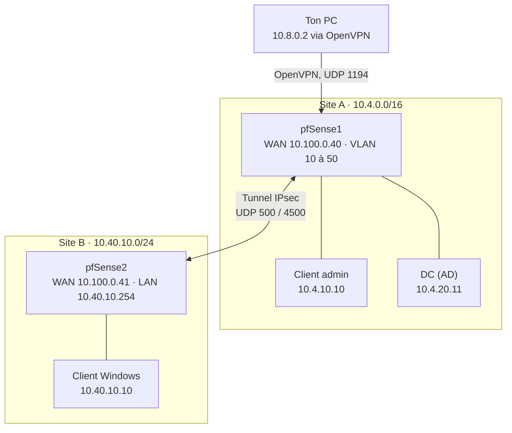

# Tunnel IPsec site à site pfSense – Guide débutant

Ce guide explique, pas à pas, comment relier deux sites distants (site A et site B) avec un tunnel IPsec entre deux pare-feu pfSense, et comment accéder à un poste d'administration en RDP depuis un PC personnel via OpenVPN. Les deux sites sont simulés sur Proxmox.

À la fin, un poste du site B (10.40.10.10) joint le contrôleur de domaine du site A (10.4.20.11) et le client admin (10.4.10.10) à travers le tunnel chiffré.



Ton PC entre par OpenVPN sur pfSense1. Le tunnel IPsec relie ensuite pfSense1 à pfSense2 à travers le réseau WAN 10.100.0.0/24.

## Sommaire

1. [Vue d'ensemble](#1-vue-densemble)
2. [Glossaire pour débutant](#2-glossaire-pour-débutant)
3. [Partie 1 : accéder en RDP au client admin via OpenVPN](#3-partie-1--accéder-en-rdp-au-client-admin-via-openvpn)
4. [Partie 2 : installer la VM pfSense2 sur Proxmox](#4-partie-2--installer-la-vm-pfsense2-sur-proxmox)
5. [Partie 3 : configurer les IP de pfSense2](#5-partie-3--configurer-les-ip-de-pfsense2)
6. [Partie 4 : ouvrir UDP 500 et 4500 sur les deux WAN](#6-partie-4--ouvrir-udp-500-et-4500-sur-les-deux-wan)
7. [Partie 5 : créer le tunnel IPsec](#7-partie-5--créer-le-tunnel-ipsec-phase-1-et-phase-2)
8. [Partie 6 : les règles de pare-feu du tunnel](#8-partie-6--les-règles-de-pare-feu-du-tunnel)
9. [Partie 7 : démarrer le tunnel et le tester](#9-partie-7--démarrer-le-tunnel-et-le-tester)
10. [Dépannage](#10-dépannage)
11. [Pour finir : sécuriser et documenter](#11-pour-finir--sécuriser-et-documenter)

## 1. Vue d'ensemble

### Plan d'adressage

| Élément | Site A (pfSense1) | Site B (pfSense2) |
| --- | --- | --- |
| Nom de la VM | GRP4-FW-pfSense1 | GRP4-FW-pfSense2 |
| IP WAN | 10.100.0.40/24 | 10.100.0.41/24 |
| Passerelle WAN | 10.100.0.1 | 10.100.0.1 |
| Réseau LAN principal | 10.0.0.0/24 (IP 10.0.0.254) | 10.40.0.0/24 (IP 10.40.0.254) |
| Réseau à joindre via le tunnel | 10.4.0.0/16 (VLAN 10 à 50) | 10.40.10.0/24 (VLAN 100, passerelle 10.40.10.254) |
| Réseau OpenVPN | 10.8.0.0/24 | non utilisé |
| Postes clés | Client admin 10.4.10.10, DC 10.4.20.11 | Client Windows 10.40.10.10 |

Les VLAN du site A sont : ADMIN (10), INFRA_AD (20), SRV_LINUX (30), DATAS (40), BACKUP (50). Chacun a sa passerelle en 10.4.X.254.

## 2. Glossaire pour débutant

Tous ces mots reviennent dans le guide. Relis ce tableau si un terme te bloque.

| Terme | Ce que c'est | Image simple |
| --- | --- | --- |
| pfSense | Un pare-feu/routeur logiciel installé ici dans une VM. Il filtre et fait circuler le trafic entre les réseaux. | Le vigile et le carrefour d'un quartier |
| WAN | Le côté « extérieur » du pfSense (ici le réseau 10.100.0.0/24). | La porte d'entrée sur la rue |
| LAN | Le côté « intérieur » : le réseau local protégé. | L'intérieur de la maison |
| VLAN | Un réseau virtuel séparé, repéré par un numéro (tag). Ici 10, 20, 30, 40, 50 au site A et 100 au site B. | Des pièces séparées dans le même bâtiment |
| Passerelle | L'adresse du routeur qui permet de sortir d'un réseau. | La porte de sortie de la pièce |
| OpenVPN | Un VPN pour te connecter depuis ton PC au réseau du site A. | Un tunnel privé de ton PC vers le bureau |
| IPsec | Un VPN pour relier deux réseaux entiers entre eux, de pare-feu à pare-feu. | Un couloir fermé entre deux bâtiments |
| Phase 1 | La première étape IPsec : les deux pfSense s'identifient et créent un canal sécurisé. | Se présenter et s'accorder sur un code |
| Phase 2 | La deuxième étape : on définit quels réseaux passent dans le tunnel. | Choisir quelles pièces sont reliées |
| PSK | Pre-Shared Key : un mot de passe long, identique sur les deux pfSense. | Le mot de passe commun du couloir |
| NAT-T | Option qui fait passer IPsec à travers du NAT (port UDP 4500). | Un adaptateur pour passer un point de contrôle |
| UDP 500 / 4500 | Les ports que le pare-feu doit laisser passer pour que IPsec démarre. | Les portes à ouvrir |
| Certificat | Une carte d'identité numérique, utilisée par OpenVPN pour authentifier ton PC. | Un badge d'accès |
| RDP | Remote Desktop Protocol (port TCP 3389) : prendre la main sur un PC Windows à distance. | Le télébureau |
| ICMP / ping | Un test simple pour savoir si une machine répond. | Frapper à la porte |

## 3. Partie 1 : accéder en RDP au client admin via OpenVPN

But : depuis ton PC personnel, ouvrir une session RDP sur le client Windows admin (10.4.10.10) en passant par OpenVPN, pfSense1 et Proxmox. Trajet : PC, tunnel OpenVPN, pfSense1, VLAN 10, client admin.

### 3.1 Retrouver l'interface web de pfSense1

Après le changement de réseau, l'ancienne adresse n'existe plus. Depuis le client admin, ouvre https://10.4.10.254. Sinon, ouvre la console de la VM pfSense1 dans Proxmox : le menu texte affiche les IP des interfaces.

### 3.2 Mettre à jour le serveur OpenVPN

1. Dans pfSense1 : **VPN, OpenVPN, Servers**, puis le crayon sur ton serveur.
2. Dans **IPv4 Local network(s)**, mets `10.4.0.0/16` (il couvre les VLAN 10 à 50). Vérifie qu'il ne chevauche pas le réseau du tunnel `10.8.0.0/24`.
3. Dans les serveurs DNS poussés, garde `10.4.20.11` (le DC) en premier et retire les adresses obsolètes.
4. Clique sur **Save**, puis **Apply Changes**.

### 3.3 Vérifier que le service tourne

Va dans **Status, OpenVPN**. Si tu vois « Unable to contact daemon / Service not running », clique sur le bouton bleu ▶ (Start) en bas à droite du tableau. Le serveur doit passer à l'état « up ». Si ça ne démarre pas, lis **Status, System Logs, OpenVPN**.

### 3.4 Règles et redirection

- **Firewall, Rules, WAN** : une règle IPv4 UDP vers « WAN address », port 1194 doit exister.
- **Firewall, Rules, OpenVPN** : autorise la source 10.8.0.0/24 vers 10.4.10.0/24 (au moins TCP 3389).
- Le WAN de pfSense1 est en IP privée (10.100.0.40) : l'équipement en amont doit rediriger UDP 1194 vers 10.100.0.40. Sans ça, ton client OpenVPN n'obtient aucune réponse.

### 3.5 Faut-il refaire l'export du fichier .ovpn ?

**Non, en général.** Le réseau local et le DNS sont envoyés au client à chaque connexion, ils ne sont pas dans le fichier. Refais l'export (package openvpn-client-export) uniquement si l'IP publique, le port, le protocole ou les certificats ont changé.

### 3.6 Se connecter et tester

1. Lance OpenVPN GUI avec ton fichier .ovpn. Message attendu : « connecté », avec une IP en 10.8.0.x.
2. Sur **ton PC** (pas sur le client admin), dans PowerShell :

```powershell
Test-NetConnection 10.4.10.10 -Port 3389
```

`TcpTestSucceeded : True` signifie que le chemin est ouvert. Lance alors `mstsc` et connecte-toi à 10.4.10.10.

**Piège vu en pratique :** `nc` n'existe pas sous Windows, et un ping vers sa propre IP répond toujours sans rien prouver.

## 4. Partie 2 : installer la VM pfSense2 sur Proxmox

On installe pfSense2 à partir de l'ISO, sur un disque vide. Le clonage de pfSense1 est déconseillé : il copierait les certificats, les VLAN, le serveur OpenVPN et les mêmes adresses IP, ce qui crée des conflits.

### 4.1 Créer la VM

1. Dans Proxmox, crée une VM avec l'ISO pfSense, un disque virtuel et au moins 2 Go de RAM.
2. Ajoute **deux cartes réseau** de modèle Intel E1000 :
    - **net0 (WAN)** : bridge `vmbr0`, le même que le WAN de pfSense1, **sans VLAN Tag**.
    - **net1 (LAN)** : le bridge du site B, **sans VLAN Tag** : le VLAN 100 sera créé dans pfSense (section 5.3).
3. Décoche la case *Firewall* sur les cartes réseau pour éviter qu'elle interfère.

### 4.2 Lancer l'installeur

| Écran | Choix |
| --- | --- |
| Partitioning | **Auto (UFS)** : adapté à une VM, Proxmox gère déjà les sauvegardes et snapshots |
| Partition Scheme | **GPT** (MBR est sélectionné par défaut : monte d'un cran avant de valider) |
| Résumé | **Finish**, puis **Commit** |
| Fin d'installation | Avant de redémarrer, retire l'ISO dans Proxmox (Hardware, CD/DVD, *Do not use any media*) |

### 4.3 Premier démarrage et assignation des interfaces

Si tu ajoutes la 2e carte après coup, **redémarre la VM** pour qu'elle apparaisse (`em1`). Dans la console, tape `1` (Assign Interfaces) :

1. *Should VLANs be set up now?* : `n` (on créera le VLAN 100 ensuite, dans l'interface web).
2. WAN : `em0`.
3. LAN : `em1`.
4. Optional 1 : laisse vide (Entrée), puis `y` pour valider.

Si `em1` est refusé (« Invalid interface name »), la 2e carte n'existe pas encore dans la VM : ajoute-la dans Proxmox et redémarre.

**Attention :** vérifie toujours que tu es dans la console de pfSense2 et pas de pfSense1. Un écran qui montre `ovpns1` et des interfaces `em1.10` à `em1.50` est celui de pfSense1. Appuie sur Ctrl+C pour en sortir sans rien changer.

## 5. Partie 3 : configurer les IP de pfSense2

Il n'y a pas de DHCP sur les pfSense : toutes les adresses sont fixes. Les deux IP à régler sont celle du WAN (10.100.0.41) et celles du côté local.

### 5.1 IP du WAN (console)

Dans la console de pfSense2, tape `2` (Set interface(s) IP address), puis choisis l'interface **1 (WAN)** :

1. *Configure IPv4 address WAN interface via DHCP?* : `n`
2. Adresse IPv4 : `10.100.0.41`
3. Masque (bit count) : `24`
4. Passerelle amont : `10.100.0.1`
5. IPv6 via DHCP6 : `n`, puis Entrée pour ne rien saisir.
6. *Revert to HTTP for the webConfigurator?* : `n`

Le menu doit afficher `WAN (wan) -> em0 -> v4: 10.100.0.41/24`.

**Vérifier ce que la carte utilise vraiment :** console, option `8` (Shell), puis `ifconfig em0`. La ligne `inet` doit afficher `10.100.0.41`. Dans l'interface web, **Status, Interfaces** montre l'état réel, alors que **Interfaces, WAN** montre seulement ce qui est enregistré. Après une modification dans la page de configuration, il faut cliquer sur **Save** puis **Apply Changes**. Sans ça, l'ancienne IP reste active.

### 5.2 IP du LAN (console)

Option `2`, interface **2 (LAN)** : IPv4 `10.40.0.254`, masque `24`, pas de passerelle (Entrée), pas d'IPv6. Réponds `n` à la question sur le HTTP pour garder le HTTPS.

L'interface web est alors accessible en https://10.40.0.254 depuis ce réseau.

### 5.3 Créer le VLAN 100 du site B (interface web)

Le réseau à relier au site A est `10.40.10.0/24` (VLAN 100). Dans l'interface web de pfSense2 :

1. **Interfaces, Assignments, VLANs, Add** : Parent Interface `em1`, VLAN Tag `100`, description `SITEB`. Save.
2. Onglet **Interface Assignments** : à la ligne « Available network ports », choisis `VLAN 100 on em1`, clique sur **Add**. L'interface devient `OPT1`.
3. Clique sur OPT1 : coche **Enable interface**, renomme-la `SITEB`, IPv4 Configuration Type **Static IPv4**, adresse `10.40.10.254`, masque `24`. Save, puis **Apply Changes**.

Le menu de la console doit alors afficher `SITEB (opt1) -> em1.100 -> v4: 10.40.10.254/24`.

### 5.4 Premiers réglages dans l'interface web

- Connexion par défaut : `admin` / `pfsense`. Change le mot de passe tout de suite.
- **System, General Setup** : hostname `GRP4-FW-pfSense2`, domaine `claas.lan`, DNS `10.4.20.11`.
- **Interfaces, WAN** : décoche **Block private networks and loopback addresses**. Le WAN est en IP privée et pfSense bloquerait sinon le trafic de l'autre site, dont IPsec. Fais pareil sur pfSense1 (déjà décoché dans notre cas).

### 5.5 Tester que les deux WAN sont sur le même réseau

Le ping entre les deux WAN peut échouer : le pare-feu WAN de chaque pfSense bloque l'ICMP entrant par défaut. Ce n'est **pas** un signe de panne. Le bon test est la table ARP :

- Sur pfSense1 : **Diagnostics, ARP Table**. Une ligne WAN avec `10.100.0.41` et sa MAC prouve que les deux VM se voient au niveau Ethernet.
- Si la ligne manque, vérifie dans Proxmox que `net0` des deux VM est sur le même bridge (`vmbr0`), sans VLAN Tag.

## 6. Partie 4 : ouvrir UDP 500 et 4500 sur les deux WAN

IPsec démarre par des échanges sur deux ports UDP. Par défaut, le pare-feu bloque tout ce qui arrive sur le WAN : il faut donc autoriser ces ports, uniquement depuis l'autre pfSense.

| Sur | Source à autoriser |
| --- | --- |
| pfSense2 | 10.100.0.40 (le WAN de pfSense1) |
| pfSense1 | 10.100.0.41 (le WAN de pfSense2) |

### 6.1 Première règle : ISAKMP (port 500)

Dans **Firewall, Rules, WAN**, clique sur **Add** :

1. Action : **Pass**. Interface : **WAN**. Address Family : **IPv4**. Protocol : **UDP**.
2. Source : **Network**, saisis l'IP de l'autre WAN (voir tableau), et choisis le masque **32** dans le menu à droite (une seule adresse).
3. Destination : **WAN address**.
4. Destination Port Range, « From » : **ISAKMP (500)**. Le champ « To » peut rester vide ou identique.
5. Description : `IPsec ISAKMP`.
6. Clique sur **Save**.

### 6.2 Deuxième règle : NAT-T (port 4500)

Sur la règle que tu viens de créer, clique sur l'icône **copie** (les deux carrés). Change le port de destination pour **IPsec NAT-T (4500)** et la description pour `IPsec NAT-T`. **Save**.

Puis clique sur **Apply Changes** (bandeau en haut de la liste). Sans cette étape, rien n'est actif.

### 6.3 Vérification

Tu dois voir deux règles IPv4 UDP avec coche verte, source = l'IP de l'autre WAN, destination « WAN address », ports 500 et 4500. Sur pfSense1, ta règle OpenVPN (UDP 1194) reste intacte : ne la modifie pas.

Réalise ces deux règles **sur pfSense2 et sur pfSense1**.

## 7. Partie 5 : créer le tunnel IPsec (Phase 1 et Phase 2)

On configure d'abord pfSense2, puis pfSense1 avec les mêmes valeurs **inversées**. Les algorithmes, la clé et les durées doivent être identiques des deux côtés, sinon le tunnel ne monte pas.

### 7.1 Phase 1 sur pfSense2

**VPN, IPsec, Tunnels, Add P1** :

| Champ | Valeur |
| --- | --- |
| Key Exchange version | IKEv2 |
| Internet Protocol | IPv4 |
| Interface | WAN |
| Remote Gateway | `10.100.0.40` |
| Description | `Vers site A` |
| Authentication Method | Mutual PSK |
| My identifier | My IP address |
| Peer identifier | Peer IP address |
| Pre-Shared Key | clique sur **Generate new Pre-Shared Key**, puis **copie la clé** dans un gestionnaire de mots de passe |
| Encryption Algorithm | AES, 256 bits |
| Hash | SHA256 |
| DH Group | 14 (2048 bit) |
| Lifetime | 28800 |
| NAT Traversal | Auto |

Laisse les autres champs par défaut. **Save**, puis **Apply Changes**.

### 7.2 Phase 2 sur pfSense2

Sous la Phase 1, clique sur **Show Phase 2 Entries**, puis **Add P2** :

| Champ | Valeur |
| --- | --- |
| Mode | Tunnel IPv4 |
| Local Network | Network, `10.40.10.0` / **24** |
| Remote Network | Network, `10.4.0.0` / **16** |
| Description | `LAN B vers LAN A` |
| Protocol | ESP |
| Encryption Algorithms | AES 256 bits uniquement |
| Hash Algorithms | SHA256 uniquement |
| PFS key group | 14 (2048 bit) |
| Lifetime | 3600 |

**Save**, puis **Apply Changes**.

### 7.3 Le même tunnel sur pfSense1

Mêmes écrans, avec ces différences :

| Champ | pfSense2 | pfSense1 |
| --- | --- | --- |
| Phase 1, Remote Gateway | `10.100.0.40` | `10.100.0.41` |
| Phase 1, Description | Vers site A | Vers site B |
| Phase 1, Pre-Shared Key | générée | **colle la même clé** (ne pas en générer une autre) |
| Phase 2, Local Network | `10.40.10.0/24` | `10.4.0.0/16` |
| Phase 2, Remote Network | `10.4.0.0/16` | `10.40.10.0/24` |

Tous les autres champs (IKEv2, AES 256, SHA256, DH 14, PFS 14, durées) restent identiques. **Save**, puis **Apply Changes**.

**Pourquoi 10.4.0.0/16 ?** Cette seule plage couvre les cinq VLAN du site A (10.4.10.0 à 10.4.50.0). Si tu ne veux exposer qu'un VLAN, mets plutôt par exemple `10.4.10.0/24`.

## 8. Partie 6 : les règles de pare-feu du tunnel

Le tunnel peut être monté sans que le trafic passe : une fois dans le tunnel, le pare-feu applique encore ses règles. Il faut une règle à deux endroits : sur l'onglet **IPsec** et sur l'interface d'où part le trafic.

### 8.1 Règles de l'onglet IPsec

**Firewall, Rules, IPsec, Add** :

| Sur | Action | Protocole | Source | Destination |
| --- | --- | --- | --- | --- |
| pfSense1 | Pass | Any (pour tester) | Network `10.40.10.0/24` | Network `10.4.0.0/16` |
| pfSense2 | Pass | Any (pour tester) | Network `10.4.0.0/16` | Network `10.40.10.0/24` |

Description conseillée : `Site B vers site A` et `Site A vers site B`. **Save**, puis **Apply Changes**.

### 8.2 Règles sur les interfaces

- **pfSense2, onglet SITEB** : une règle « IPv4 * any vers any » laisse tout sortir. C'est pratique pour tester.
- **pfSense1, onglet ADMIN** : le client admin doit pouvoir envoyer vers 10.40.10.0/24. Les règles existantes (Tests de connectivité, Administration RDP / SSH / WinRM) visent l'alias `RFC1918`. Vérifie dans **Firewall, Aliases** que cet alias contient bien `10.0.0.0/8`, sinon 10.40.10.0/24 n'est pas couvert.
- L'ordre compte : une règle de blocage (par exemple l'isolation entre VLAN) doit rester **sous** les règles qui autorisent le flux.

### 8.3 Pare-feu des postes Windows

Le pare-feu Windows d'un poste bloque par défaut le ping venant d'un autre réseau. Pour autoriser l'ICMP depuis le site B sur un poste du site A, ouvre PowerShell **en administrateur** sur ce poste :

```powershell
New-NetFirewallRule -DisplayName "ICMP depuis site B" -Protocol ICMPv4 -IcmpType 8 -RemoteAddress 10.40.10.0/24 -Action Allow
```

Sans cette règle, le ping échoue même si le tunnel est bon, alors que le RDP (TCP 3389) passe.

## 9. Partie 7 : démarrer le tunnel et le tester

### 9.1 Démarrer

1. Sur pfSense2 : **Status, IPsec, Overview**.
2. Sur la ligne du tunnel, clique sur **Connect P1 and P2s** (ou *Connect VPN*).
3. Attends 10 à 20 secondes, puis recharge la page.

Résultat attendu, sur **les deux** pfSense : la Phase 1 est **Established**, et le bouton « Show child SA entries » indique **1 Connected**. Les algorithmes affichés sont AES_CBC (256), HMAC_SHA2_256_128 et MODP_2048. Dans notre cas, pfSense2 est l'**Initiator** et pfSense1 le **Responder**.

### 9.2 Tests, du plus simple au plus complet

| Test | Où le lancer | Commande ou action | Résultat attendu |
| --- | --- | --- | --- |
| Ping de la passerelle B | Client admin du site A | `ping 10.40.10.254` | 4 réponses, TTL 63 |
| Ping du DC | Client du site B | `ping 10.4.20.11` | 4 réponses, TTL 126 |
| Ping d'un poste Windows du site A | Client du site B | `ping 10.4.10.10` | peut échouer : pare-feu Windows (voir 8.3) |
| Port RDP du client admin | Client du site B | `Test-NetConnection 10.4.10.10 -Port 3389` | `TcpTestSucceeded : True` |
| DNS du domaine | Client du site B | `nslookup claas.lan 10.4.20.11` | le DC répond |

Le TTL aide à comprendre le chemin : 63 vers pfSense2 depuis le client admin (un routeur traversé), 126 vers le DC depuis le site B (deux routeurs traversés).

### 9.3 Configuration du poste du site B

Les postes ont une IP fixe (pas de DHCP). Sur le client du site B : IP `10.40.10.10`, masque `255.255.255.0`, passerelle `10.40.10.254`, DNS `10.4.20.11`.

### 9.4 Résultat obtenu dans ce lab

- Tunnel IPsec **Established** des deux côtés, AES-256 / SHA-256 / DH 14.
- Ping du client admin vers 10.40.10.254 : 4/4.
- Ping du client du site B vers le DC 10.4.20.11 : 4/4.
- Test RDP du site B vers 10.4.10.10 : réussi.
- `nslookup` vers le DC : réussi.

## 10. Dépannage

Pour toute panne IPsec, commence par **Status, System Logs, IPsec** sur les deux pfSense. Pour une panne de pare-feu, regarde **Status, System Logs, Firewall** et cherche une ligne rouge (bloqué).

| Symptôme | Cause probable | Que faire |
| --- | --- | --- |
| OpenVPN : « TLS key negotiation failed », 0 octet entrant | Le serveur ne répond pas : service arrêté, WAN modifié ou redirection UDP 1194 supprimée | Status, OpenVPN : démarre le service (▶), vérifie l'IP WAN et la redirection en amont |
| OpenVPN : « Unable to contact daemon » | Le service OpenVPN est arrêté | Bouton ▶ dans Status, OpenVPN, puis lis les logs OpenVPN |
| Console : « Invalid interface name 'em1' » | La 2e carte réseau n'existe pas dans la VM | Ajoute-la dans Proxmox, redémarre la VM |
| Status, Interfaces affiche une autre IP que celle saisie | La modification n'a pas été appliquée | Save puis Apply Changes, ou passe par la console (option 2), et contrôle avec `ifconfig em0` |
| Ping entre WAN : 100 % de perte | Le pare-feu WAN bloque l'ICMP entrant | Teste avec la table ARP (Diagnostics, ARP Table), pas avec le ping |
| IPsec : `no proposal chosen` | Un algorithme diffère entre les deux pfSense | Compare les deux Phase 1 et Phase 2 ligne par ligne |
| IPsec : `authentication failed` | La clé PSK est différente | Recopie la clé sans espace en trop |
| Rien dans les logs IPsec | UDP 500 ou 4500 n'arrive pas | Vérifie les règles WAN (partie 6) et que les deux WAN sont sur le même bridge |
| Phase 1 établie, ping impossible | Règle de pare-feu manquante, ou Phase 2 absente | Vérifie l'onglet IPsec (8.1) et la règle de l'interface de départ |
| Le ping vers un PC Windows échoue, le RDP marche | Le pare-feu Windows bloque l'ICMP | Règle ICMP (8.3), ou teste avec `Test-NetConnection` |
| `nc` : commande introuvable | `nc` n'existe pas sous Windows | `Test-NetConnection IP -Port 3389` |
| Ping de pfSense avec la source WAN, tunnel monté | Le ping ne passe pas dans le tunnel | Dans Diagnostics, Ping, choisis comme source l'interface du réseau local (ADMIN ou SITEB) |

### Erreurs de manipulation fréquentes

- **Mauvaise console** : vérifie qu'un écran qui montre `ovpns1` et `em1.10` à `em1.50` est pfSense1. Ne tape rien dedans si tu configures pfSense2.
- **Oubli de Apply Changes** : la plupart des modifications de l'interface web n'ont d'effet qu'après ce bouton.
- **Ping vers sa propre IP** : il répond toujours et ne teste rien. Teste vers la machine distante.

## 11. Pour finir : sécuriser et documenter

Le tunnel fonctionne avec des règles larges, pratiques pour tester. Avant de considérer le travail terminé, passe par cette liste.

- [ ] Remplacer la règle « any vers any » de l'onglet SITEB (pfSense2) par les flux de la matrice : DNS (TCP/UDP 53), Kerberos (88), LDAP (389), SMB (445), RDP (3389), selon ce que le site B doit atteindre.
- [ ] Faire de même sur l'onglet IPsec des deux pfSense (remplacer « Any » par des ports précis).
- [ ] Changer le mot de passe admin de pfSense2 et le ranger avec la clé PSK dans un gestionnaire de mots de passe.
- [ ] Vérifier que le WAN de pfSense2 est en **Static IPv4** (Interfaces, WAN) et que le tunnel se rétablit seul après un redémarrage d'un pfSense.
- [ ] Si les clients OpenVPN doivent aussi atteindre le site B : ajouter `10.40.10.0/24` aux *Local Network(s)* du serveur OpenVPN de pfSense1, puis une règle sur l'onglet OpenVPN.
- [ ] Contrôler l'alias `RFC1918` de pfSense1 (doit contenir `10.0.0.0/8`).
- [ ] Mettre à jour la matrice de flux : tunnel IPsec 10.100.0.40 <-> 10.100.0.41 (UDP 500 et 4500), réseau 10.40.10.0/24, flux autorisés entre les sites.
- [ ] Faire un snapshot Proxmox des deux pfSense une fois la configuration validée, et exporter la configuration (Diagnostics, Backup & Restore).

### Récapitulatif des adresses à retenir

| Élément | Valeur |
| --- | --- |
| WAN pfSense1 / pfSense2 | 10.100.0.40 / 10.100.0.41 |
| Passerelle WAN | 10.100.0.1 |
| Interface web pfSense1 (depuis VLAN ADMIN) | https://10.4.10.254 |
| Interface web pfSense2 (depuis le LAN B) | https://10.40.0.254 ou https://10.40.10.254 |
| Tunnel IPsec, Phase 2 | 10.4.0.0/16 <-> 10.40.10.0/24 |
| Client admin / DC (site A) | 10.4.10.10 / 10.4.20.11 |
| Client Windows (site B) | 10.40.10.10 |
| Tunnel OpenVPN | 10.8.0.0/24 |
